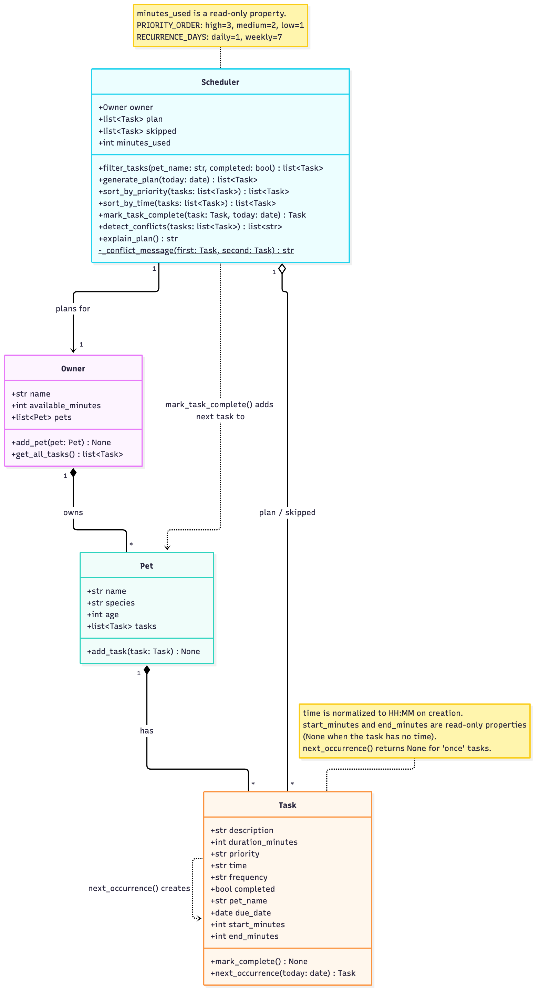

# 🐾 PawPal+

**PawPal+** is a pet care planner for busy owners. You tell it about your pets, their care tasks (walks, feeding, meds, grooming…), and how much time you have today. It builds a daily plan that fits your time, puts the most important tasks first, warns you about time clashes, and explains why it chose each task.

It has two parts:

- **`pawpal_system.py`**: the logic layer with the `Owner`, `Pet`, `Task`, and `Scheduler` classes.
- **`app.py`**: a Streamlit web app built on top of that logic. `main.py` is a terminal demo of the same logic.

## ✨ Features

- **Priority-based daily planning:** `generate_plan()` takes tasks from high to low priority (shorter tasks first on ties) and adds each one only if it still fits in the owner's minutes left. If a big task doesn't fit, smaller tasks after it can still get in. Tasks that don't fit are listed as skipped.
- **Sorting by time:** `sort_by_time()` turns `"HH:MM"` into minutes after midnight before comparing, so `"8:00"` comes before `"10:00"`. Tasks with no set time go at the end.
- **Time validation:** times are checked when a task is created. `"8:00"` is saved as `"08:00"`, and impossible times like `"25:00"` are rejected.
- **Filtering:** `filter_tasks()` shows tasks for one pet, by done / not done, or both.
- **Conflict warnings:** `detect_conflicts()` flags tasks that start at the same time *or* overlap (a 30 min walk at 07:30 clashes with feeding at 07:45). It checks across all pets, because the owner can't be in two places at once. Back-to-back tasks and tasks on different days are not flagged.
- **Daily and weekly recurrence:** marking a `"daily"` task complete adds a new copy due tomorrow, and a `"weekly"` task adds one due in 7 days. `"once"` tasks don't repeat. Dates are counted from today or the task's due date, whichever is later, so a task finished late doesn't come back already overdue and one finished early doesn't come back due on the same day.
- **Due dates:** the plan only includes tasks that aren't done yet and are due today or earlier.
- **Plan explanations:** `explain_plan()` says why each task was chosen, why any were skipped, and lists conflicts.

## 🚀 Getting started

### Setup

```bash
python -m venv .venv
source .venv/bin/activate  # Windows: .venv\Scripts\activate
pip install -r requirements.txt
```

### Run it

```bash
streamlit run app.py   # the web app
python main.py         # terminal demo
python -m pytest       # tests
```

## 📸 Demo Walkthrough

### Main UI features

The Streamlit app is one page with four sections, top to bottom:

| Section | What you can do |
|---------|-----------------|
| **Owner** | Set your name and how many minutes you have for pet care today. |
| **Pets** | Add a pet (name, species, age). A table lists your pets and how many tasks each has. Empty or duplicate pet names show an error. |
| **Tasks** | Add a task for a pet: description, optional time (`HH:MM`), duration, priority, and how often it repeats. Filter the task list by pet and by *To do / Done / All*; it's always shown in time order. Pick a task from **Mark a task as done** to complete it. |
| **Today's Schedule** | Click **Generate schedule** to see the plan: tasks planned, minutes used with a progress bar, the plan in time order, conflict warnings, skipped tasks, and a **Why this plan?** explanation. |

Your pets and tasks are kept in `st.session_state`, so they stay while you click around. Refreshing the page starts over.

### Example workflow

1. **Set up the owner.** Enter your name and set *Minutes available today* to `60`.
2. **Add pets.** Add **Mochi** (dog, 3) and then **Luna** (cat, 5). Both appear in the Pets table with 0 tasks.
3. **Add tasks.**
   - For Mochi: *Morning walk*, time `7:30`, 30 min, high priority, daily.
   - For Luna: *Feed*, time `07:45`, 5 min, high priority, daily.
   - For Mochi: *Bath*, no time, 45 min, low priority, weekly.

   The task list shows them sorted by time, with `7:30` saved as `07:30` and Bath (no time) at the bottom.
4. **Filter.** Set *Show pet* to **Luna** to see only Feed. Set it back to *All pets*.
5. **Generate the schedule.** Click **Generate schedule**:
   - Walk and Feed are planned (35 of 60 min). Bath is listed under **Didn't fit in today's time**, because 45 more minutes would go over 60.
   - A yellow warning says *"⚠️ 1 time clash(es) in today's plan"*: *Overlap (Mochi and Luna): Morning walk 07:30-08:00 and Feed at 07:45*, with a tip to move the later task. Both rows are marked **⚠️ clash** in the table.
   - **Why this plan?** explains each choice in plain sentences.
6. **Complete a recurring task.** Under *Mark a task as done*, choose *07:30 Morning walk (Mochi…)* and click **Mark complete**. A green message confirms it and says when the next one is due (tomorrow). Switch the status filter to **All** to see both the finished walk and tomorrow's new one.
7. **Regenerate.** The schedule updates by itself: the walk is gone from today's plan, the clash warning is replaced by a green *"No time clashes"* message, and Bath now fits.

### Scheduler behaviors shown

| Behavior | Where you see it |
|----------|------------------|
| Priority-based planning within the time limit | Step 5: high priority tasks are picked first, and Bath is skipped |
| Sorting by time | Steps 3 and 5: task list and schedule are in clock order, with no-time tasks last |
| Time validation | Step 3: `7:30` is saved as `07:30` (a bad time like `25:00` shows an error) |
| Filtering | Step 4: by pet, and step 6: by done / not done |
| Conflict warnings | Step 5: overlap across two pets is flagged, and step 7: the green "no clashes" message |
| Daily recurrence | Step 6: completing a daily task adds tomorrow's copy |
| Plan explanation | Step 5: the **Why this plan?** expander |

### CLI demo (`python main.py`)

`main.py` runs the same logic in the terminal, with an owner who has 90 minutes and two pets. It shows the plan, conflict detection, recurring tasks, and sorting and filtering:

```
====================================================
  Today's Schedule for Shruti
====================================================
  Time   Task            Pet      Min  Priority
  ------------------------------------------------
  07:30  Morning walk    Mochi     30  high
  07:45  Feed            Luna       5  high
  08:00  Breakfast       Mochi     10  high
  18:00  Brush fur       Luna      15  medium
  --:--  Play time       Luna      20  medium
  ------------------------------------------------
  Time used: 80 / 90 min

  Warning, overlapping tasks:
  ! Overlap (Mochi and Luna): Morning walk 07:30-08:00 and Feed at 07:45

Why this plan:
Plan for Shruti: 80 of 90 minutes used.
- 07:30 Morning walk (Mochi, 30 min): chosen because it is high priority and fit in the time left.
- 07:45 Feed (Luna, 5 min): chosen because it is high priority and fit in the time left.
- 08:00 Breakfast (Mochi, 10 min): chosen because it is high priority and fit in the time left.
- 18:00 Brush fur (Luna, 15 min): chosen because it is medium priority and fit in the time left.
- Play time (Luna, 20 min): chosen because it is medium priority and fit in the time left.
- Conflict: Overlap (Mochi and Luna): Morning walk 07:30-08:00 and Feed at 07:45

--- Conflict detection ---
Found 3 conflict(s) in today's tasks:
  WARNING: Overlap (Mochi and Luna): Morning walk 07:30-08:00 and Feed at 07:45
  WARNING: Same time (both for Mochi): Breakfast 08:00-08:10 and Meds at 08:00
  WARNING: Same time (Mochi and Luna): Evening walk 18:00-18:20 and Brush fur at 18:00

--- Recurring tasks ---
Completed Morning walk (daily): next one is due 2026-10-12.
Completed Bath (weekly): next one is due 2026-10-25.
Completed Vet checkup (once): no repeat.

--- Sorting and filtering ---

All tasks, in the order they were added:
  08:00  Breakfast     Mochi  todo  due 2026-10-11
  07:30  Morning walk  Mochi  done  due 2026-10-11
  16:00  Bath          Mochi  done  due 2026-10-18
  08:00  Meds          Mochi  todo  due 2026-10-11
  18:00  Evening walk  Mochi  todo  due 2026-10-11
  07:30  Morning walk  Mochi  todo  due 2026-10-12
  16:00  Bath          Mochi  todo  due 2026-10-25
  18:00  Brush fur     Luna   todo  due 2026-10-11
  07:45  Feed          Luna   todo  due 2026-10-11
  --:--  Play time     Luna   todo  due 2026-10-11
  --:--  Vet checkup   Luna   done  due 2026-10-11

All tasks, sorted by time:
  07:30  Morning walk  Mochi  done  due 2026-10-11
  07:30  Morning walk  Mochi  todo  due 2026-10-12
  07:45  Feed          Luna   todo  due 2026-10-11
  08:00  Breakfast     Mochi  todo  due 2026-10-11
  08:00  Meds          Mochi  todo  due 2026-10-11
  16:00  Bath          Mochi  done  due 2026-10-18
  16:00  Bath          Mochi  todo  due 2026-10-25
  18:00  Evening walk  Mochi  todo  due 2026-10-11
  18:00  Brush fur     Luna   todo  due 2026-10-11
  --:--  Play time     Luna   todo  due 2026-10-11
  --:--  Vet checkup   Luna   done  due 2026-10-11

Luna's tasks, sorted by time:
  07:45  Feed          Luna   todo  due 2026-10-11
  18:00  Brush fur     Luna   todo  due 2026-10-11
  --:--  Play time     Luna   todo  due 2026-10-11
  --:--  Vet checkup   Luna   done  due 2026-10-11

Completed tasks:
  07:30  Morning walk  Mochi  done  due 2026-10-11
  16:00  Bath          Mochi  done  due 2026-10-18
  --:--  Vet checkup   Luna   done  due 2026-10-11

Mochi's pending tasks:
  08:00  Breakfast     Mochi  todo  due 2026-10-11
  08:00  Meds          Mochi  todo  due 2026-10-11
  18:00  Evening walk  Mochi  todo  due 2026-10-11
  07:30  Morning walk  Mochi  todo  due 2026-10-12
  16:00  Bath          Mochi  todo  due 2026-10-25
```

What this output shows:

- **Planning:** five tasks fit in 80 of 90 minutes, high priority first. The weekly Bath isn't due until next week, so it isn't in today's plan.
- **Sorting:** the tasks were added out of order (and `"7:45"` without a leading zero), but the schedule is in clock order, with *Play time* (no time) last.
- **Conflicts:** an overlap across two pets, a same-time clash for one pet, and a same-time clash across pets are all caught.
- **Recurrence:** the daily walk comes back tomorrow, the weekly bath in 7 days, and the one-time vet checkup doesn't repeat.
- **Filtering:** by pet, by done / not done, and by both together.

**Screenshot or video** *(optional)*: <!-- Insert a screenshot or link to a demo video here -->

## 📐 Architecture

The final class diagram is in [`diagrams/uml_final.mmd`](diagrams/uml_final.mmd):



## 🖥️ Sample Output

Output from running `python main.py` (owner with 90 minutes available, two pets, tasks added out of time order on purpose). Mochi's weekly Bath isn't due until next week, so it isn't in today's plan:

```
====================================================
  Today's Schedule for Shruti
====================================================
  Time   Task            Pet      Min  Priority
  ------------------------------------------------
  07:30  Morning walk    Mochi     30  high
  07:45  Feed            Luna       5  high
  08:00  Breakfast       Mochi     10  high
  18:00  Brush fur       Luna      15  medium
  --:--  Play time       Luna      20  medium
  ------------------------------------------------
  Time used: 80 / 90 min

  Warning, overlapping tasks:
  ! Overlap (Mochi and Luna): Morning walk 07:30-08:00 and Feed at 07:45

Why this plan:
Plan for Shruti: 80 of 90 minutes used.
- 07:30 Morning walk (Mochi, 30 min): chosen because it is high priority and fit in the time left.
- 07:45 Feed (Luna, 5 min): chosen because it is high priority and fit in the time left.
- 08:00 Breakfast (Mochi, 10 min): chosen because it is high priority and fit in the time left.
- 18:00 Brush fur (Luna, 15 min): chosen because it is medium priority and fit in the time left.
- Play time (Luna, 20 min): chosen because it is medium priority and fit in the time left.
- Conflict: Overlap (Mochi and Luna): Morning walk 07:30-08:00 and Feed at 07:45

--- Conflict detection ---
Found 3 conflict(s) in today's tasks:
  WARNING: Overlap (Mochi and Luna): Morning walk 07:30-08:00 and Feed at 07:45
  WARNING: Same time (both for Mochi): Breakfast 08:00-08:10 and Meds at 08:00
  WARNING: Same time (Mochi and Luna): Evening walk 18:00-18:20 and Brush fur at 18:00

--- Recurring tasks ---
Completed Morning walk (daily): next one is due 2026-10-12.
Completed Bath (weekly): next one is due 2026-10-25.
Completed Vet checkup (once): no repeat.
```

## 🧪 Testing PawPal+

Run the full test suite from the project folder (with the virtual environment active):

```bash
python -m pytest
```

### What the tests cover

The 33 tests in `tests/test_pawpal.py` check both normal use ("happy paths") and edge cases:

- **Sorting:** tasks come back in clock order (`"8:00"` before `"10:00"`, `"00:00"` first), tasks with no time go last, and tasks at the same time keep the order they were added. Priority sorting goes high → medium → low, with shorter tasks first on ties and unknown priorities last.
- **Building the plan:** high priority tasks are picked first within the owner's time, a smaller task can still fit after a big one is skipped, a task that exactly fills the time is included, and completed or not-yet-due tasks are left out. Edge cases include 0 minutes available, a pet with no tasks, and an owner with no pets.
- **Recurring tasks:** completing a daily task adds a new one for the next day (weekly adds one 7 days later), keeping the same time and priority. "Once" tasks don't repeat, completing a task twice doesn't make a duplicate, late tasks don't come back overdue, early weekly tasks are next due a week after their due date, and Dec 31 rolls over to Jan 1.
- **Conflict detection:** tasks at the exact same time or overlapping times are flagged, for the same pet or across pets. Back-to-back tasks, tasks on different days, and tasks with no time are not flagged.
- **Basics:** marking a task complete, adding tasks to a pet, filtering by pet and status, and rejecting invalid times like `"25:00"`.

### Sample test output

```
============================= test session starts ==============================
platform darwin -- Python 3.14.7, pytest-9.1.1, pluggy-1.6.0
rootdir: /Users/shrutitimalsina/Desktop/AI Engineering/Project2/pawpal-starter
plugins: anyio-4.15.1
collected 33 items

tests/test_pawpal.py .................................                   [100%]

============================== 33 passed in 0.04s ==============================
```

### Confidence level

⭐⭐⭐⭐☆ (4/5)

All 33 tests pass, and they cover the scheduler's main jobs (sorting, choosing tasks within the time limit, recurring tasks, and conflict warnings) along with the edge cases I could think of. I'm not giving it 5 stars because a few cases aren't handled yet: a task's duration can be 0 or negative, a task that runs past midnight isn't checked against the next day's tasks, and the Streamlit UI itself isn't covered by automated tests.

## 📐 Smarter Scheduling

All of this logic lives in `pawpal_system.py`. Run `python main.py` to see each feature print in the terminal.

| Feature | Method(s) | What it does |
|---------|-----------|--------------|
| Sorting by time | `Scheduler.sort_by_time()` | Puts tasks in clock order, with tasks that have no time at the end |
| Sorting by priority | `Scheduler.sort_by_priority()` | High before medium before low, shorter tasks first on ties |
| Filtering | `Scheduler.filter_tasks()` | Shows tasks for one pet, by done / not done, or both |
| Conflict detection | `Scheduler.detect_conflicts()` | Warns when tasks overlap, for the same pet or different pets |
| Recurring tasks | `Scheduler.mark_task_complete()`, `Task.next_occurrence()` | Completing a daily or weekly task adds the next one automatically |

### Sorting

- **`Scheduler.sort_by_time(tasks)`** sorts tasks by their start time. Times are turned into minutes after midnight before comparing (`"07:45"` becomes 465). This means `"8:00"` correctly comes before `"10:00"`, which wouldn't happen if the times were compared as plain text. Tasks with no time go last.
- When a task is created, its time is checked and tidied up: `"8:00"` is saved as `"08:00"`, and a time like `"25:00"` is rejected with an error right away.
- **`Scheduler.sort_by_priority(tasks)`** is what `generate_plan()` uses to choose tasks: highest priority first, and the shorter task first when two have the same priority.

### Filtering

- **`Scheduler.filter_tasks(pet_name=None, completed=None)`** returns the owner's tasks that match the filters you give it. Anything left as `None` isn't filtered on:

  ```python
  scheduler.filter_tasks(pet_name="Luna")                   # all of Luna's tasks
  scheduler.filter_tasks(completed=False)                   # everything still to do
  scheduler.filter_tasks(pet_name="Mochi", completed=True)  # what Mochi has had done
  ```
- Filters and sorting can be combined, e.g. `sort_by_time(filter_tasks(pet_name="Luna"))`.
- **`Scheduler.generate_plan()`** uses filtering too: it only plans tasks that aren't done yet and are due today or earlier.

### Conflict detection

- **`Scheduler.detect_conflicts(tasks=None)`** checks the plan (or any list of tasks you pass in) for tasks that clash. It returns a list of warning messages and never crashes the program. An empty list means no clashes.
- How it works: it puts the tasks in time order and goes through them once, keeping track of the task that ends the latest so far. If the next task starts before that one ends, it adds a warning.
- It catches **overlaps**, not only exact matches. A 30 minute walk at 07:30 clashes with feeding at 07:45. Back-to-back tasks (a walk 07:30-08:00, then breakfast at 08:00) are fine.
- It checks **across pets**, because the owner can't be in two places at once. It only compares tasks due on the **same day**, and skips tasks with no time.
- Each message says what kind of clash it is:
  ```
  Same time (both for Mochi): Breakfast 08:00-08:10 and Meds at 08:00
  Overlap (Mochi and Luna): Morning walk 07:30-08:00 and Feed at 07:45
  ```
- The warnings show in the terminal, at the end of `explain_plan()`, and in the Streamlit app.
- Tradeoff: each task is compared with the latest-ending task, not with every other task. Every clashing task still gets flagged at least once (see `reflection.md`, section 2b).

### Recurring tasks

- Each `Task` has a `frequency` (`"once"`, `"daily"`, or `"weekly"`) and a `due_date`.
- **`Scheduler.mark_task_complete(task)`** marks the task done. If it repeats, it calls **`Task.next_occurrence()`** and adds the new copy to the same pet:
  - `"daily"`: due 1 day later
  - `"weekly"`: due 7 days later
  - `"once"`: nothing is added
- The next date is worked out with Python's `timedelta`, so it handles the end of a month or year correctly. It's counted from **whichever is later, today or the task's due date**. A task finished late doesn't come back already overdue, and a weekly task finished a few days early (say, bath due Oct 18, done Oct 11) is next due a week after its due date (Oct 25), not on the same day again.
- The finished task stays in the list marked as done, so you can still see what was completed. Completing the same task twice doesn't make a second copy.
